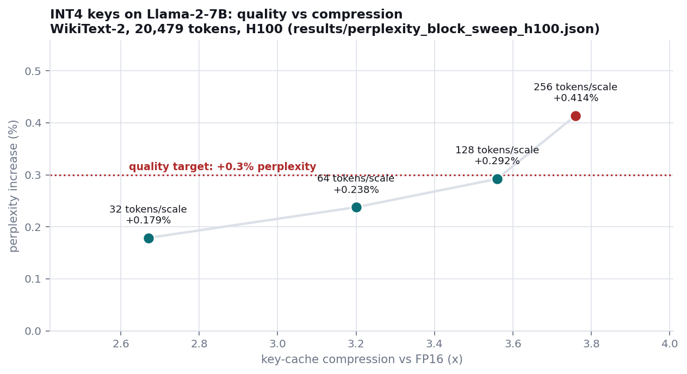
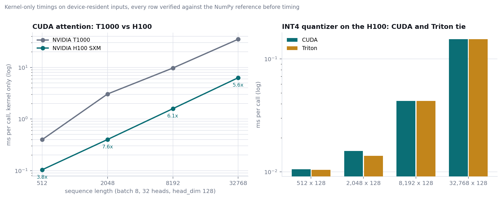
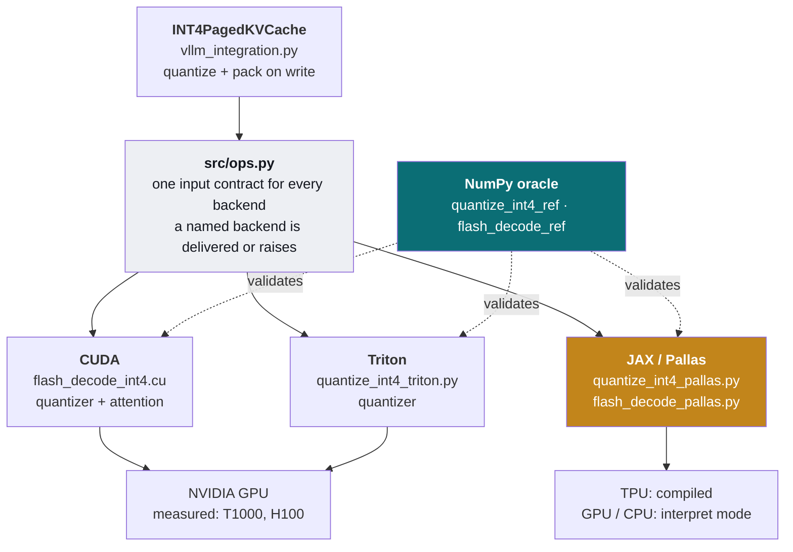
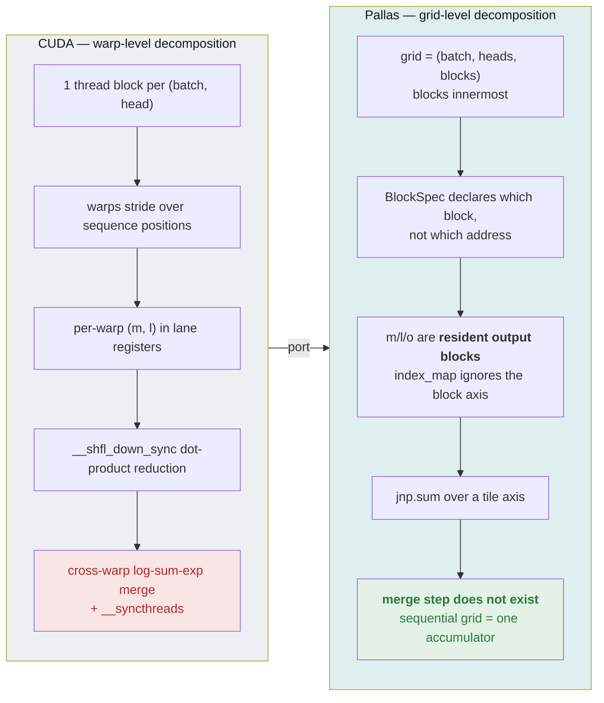

# INT4 KV-Cache Quantization + Fused Flash-Decoding Attention
### One decode kernel, three backends — CUDA, Triton and JAX/Pallas — measured on an NVIDIA H100

[](https://github.com/ArchanaChetan07/int4-kv-cache-quantization-cuda-triton-pallas/actions/workflows/ci.yml)


Per-channel asymmetric **INT4 quantization** of the KV cache's keys, fused with a
**flash-decoding attention kernel** that dequantizes in registers, so the FP32 key
matrix is never materialized. The same algorithm is implemented three times — **CUDA**,
**[Triton](https://github.com/triton-lang/triton)** and
**[JAX/Pallas](https://docs.jax.dev/en/latest/pallas/)** — and every implementation is
validated against a single NumPy oracle. Built toward paged-KV serving engines such as
[vLLM](https://github.com/vllm-project/vllm), and measured on a rented NVIDIA H100.

---

## Highlights

- **Quality target met.** INT4 keys cost Llama-2-7B **+0.292% perplexity** at
  **3.56× key-cache compression** (128-token scale groups, H100) — under the 0.3% target.
- **0.40 ms fused INT4 decode attention** (batch 8 × 32 heads × head_dim 128 × 2,048
  tokens) on an H100 SXM, 3.8–7.6× faster than the T1000 across the benchmark sweep.
- **Three backends, one oracle.** The CUDA and Pallas quantizers agree with the NumPy
  reference bit-for-bit (0.000% bin disagreement); **154 tests pass** on the H100 with
  every backend installed.
- **Finding — compiled Pallas races on GPUs.** In JAX 0.12, `pallas_call` reaches only the
  Triton backend, which runs grid steps in parallel. These kernels need them in order:
  compiled on the H100, the quantizer got 29% of its outputs wrong and nothing raised an
  error. The code now refuses that combination and explains why.
- **Finding — the kernel is latency-bound, not bandwidth-bound** (0.05–1.3% of DRAM
  bandwidth on every configuration measured), which points the next optimization at the
  per-position reduction.
- **Benchmarks that refuse to publish a wrong number.** Kernel-only timing on
  device-resident inputs, and nothing is timed until its output matches the reference.

## Tech stack

| Layer | Technologies |
|---|---|
| **GPU kernels** | CUDA C++, warp-level primitives (`__shfl_down_sync`), shared memory, online softmax, PyTorch C++ extension (pybind11) |
| **Kernel DSLs** | OpenAI Triton, JAX Pallas (Mosaic TPU, Triton GPU backend), XLA |
| **Quantization** | INT4 per-channel asymmetric quantization, nibble packing, in-register dequantization, SNR analysis |
| **Attention** | Flash decoding, FlashAttention-style online softmax, paged KV cache, ragged/variable-length sequences |
| **LLM evaluation** | Llama-2-7B perplexity on WikiText-2 via Hugging Face Transformers (`Cache.update` hook, post-RoPE keys) |
| **Hardware** | NVIDIA H100 80GB HBM3 (rented, vast.ai), NVIDIA T1000 (local); CPU-only CI via interpreters |
| **Numerics** | float64 differential testing, IEEE-754 accumulation-error bounds, NumPy reference oracles |
| **Engineering** | pytest (154 tests), GitHub Actions CI, Docker, CMake, benchmark-integrity design, reproducible charts and reports |

**Keywords:** GPU kernel optimization · CUDA programming · Triton kernels · JAX Pallas · TPU kernels ·
INT4 quantization · KV cache · FlashAttention · flash decoding · LLM inference · LLM serving · vLLM ·
model compression · memory-bandwidth analysis · numerical validation · ML systems engineering ·
AI infrastructure · high-performance computing

---

## Results

Every number below comes from committed code and a committed artifact in [`results/`](results/).
Timings cover the kernel only, on inputs already resident on the device; every benchmark
row was checked against the NumPy reference before it was timed.

### NVIDIA H100 80GB HBM3

| Measurement | Result |
|---|---|
| Test suite, every backend installed | **154 passed, 0 skipped** |
| CUDA attention, batch 8 × 32 heads × head_dim 128 × 2,048 tokens | **0.400 ms** |
| CUDA attention across the sweep (512 → 32,768 tokens) | 0.104 → 6.30 ms; **3.8–7.6×** the T1000 |
| INT4 quantizer, CUDA vs Triton | **tie** at every size (within 0.001 ms) |
| Llama-2-7B perplexity, INT4 keys, **128-token scale groups** | **+0.292%** (4.5328 → 4.5460) — passes the 0.3% target |
| Same, 256-token scale groups | +0.414% — misses the target |
| Compiled Pallas (refused by default, measured on purpose) | quantizer 28.9% of bins wrong, attention off by up to 5.4, no error raised |

### NVIDIA T1000 (local development GPU)

| Measurement | Result |
|---|---|
| Test suite, GPU mode (`FLASH_DECODE_JIT_CUDA=1`) | **121 passed** (4 skipped: JAX not installed in that environment) |
| CUDA attention, same anchor shape | **2.24 ms** median of 9 runs (2.13–2.68 ms; clocks unlocked, ±24%) |
| INT4 quantizer, CUDA vs Triton | CUDA faster at every size, by 1.05–1.62× |
| CUDA quantizer vs NumPy oracle | **0.000% bin disagreement**, scales rtol 1e-4 |
| Fused attention, *agreement* with the FP32 reference (head_dim 64) | MAE 3.1 × 10⁻⁸; ragged and empty pages ≤ 3.4 × 10⁻⁸ |

### Accuracy and compression

| Measurement | Result |
|---|---|
| Pallas quantizer vs NumPy oracle | **0.000% bin disagreement** |
| Pallas attention vs a float64 evaluation | within **1.4× of the float32 accumulation floor** on every platform tested |
| Key-cache compression vs FP16, measured from the cache's arrays | **3.76×** at 256 tokens per scale, **3.56×** at 128; ~1.56–1.58× for the whole KV (values stay FP16) |
| Quantization SNR, per-block vs whole-sequence scales (Gaussian worst case) | 19.26 dB, **+1.72 dB** |

<p align="center">
  
</p>

The scale-group size is the paged-KV block size, which every kernel takes at runtime, so
moving along this curve is configuration, not code. 128 tokens is the largest group that
meets the target, narrowly; 64 buys margin for 0.36× of compression
([`results/perplexity_block_sweep_h100.json`](results/perplexity_block_sweep_h100.json)).

<p align="center">
  
</p>

<p align="center">
  
</p>

<p align="center">
  
</p>

---

## What building it revealed

Four things this project established that its own plan got wrong, or did not expect.

**1. Compiled Pallas races on GPUs.** Both Pallas kernels keep their running totals in an
output block that stays resident across a grid axis — correct only if that axis runs in
order. That holds on TPU and in interpret mode. On an H100 with JAX 0.12.0.1,
`pallas_call` reaches only the Triton backend (Mosaic GPU registers no `pallas_call`
lowering rule) and Triton runs grid programs in parallel. Compiled anyway, the quantizer
put 28.9% of bins wrong and attention was off by up to 5.4, with no NaN and no error
([`results/pallas_compiled_on_gpu_h100.json`](results/pallas_compiled_on_gpu_h100.json)).
Compiled Pallas is therefore TPU-only as written: on GPU it is refused with that
explanation, and GPU hosts run it in interpret mode, which is correct.
[`scripts/pallas_gpu_grid_semantics.py`](scripts/pallas_gpu_grid_semantics.py)
reproduces the race in about 30 lines.

**2. The attention kernel is latency-bound.** All 256 (batch, head) programs read one
shared page stream. Counting each byte once, the kernel uses 0.3% of the T1000's DRAM
bandwidth at the anchor shape and about 0.1% of the H100's 3.35 TB/s; its streamed read
throughput even exceeds the T1000's 160 GB/s peak at short sequences, because L2 serves
the shared stream. The cost is the per-position warp-shuffle reduction and serial softmax
update, so the next optimization is tiling several positions per warp.

**3. The oracle is less accurate than the kernel it validates.** At `head_dim` 128 the
FP32 NumPy reference sits 9.26 × 10⁻⁷ from a float64 evaluation — the float32 accumulation
floor — while the Pallas kernel sits at 2.59 × 10⁻⁷. A fixed "agree with the reference to
3 × 10⁻⁸" gate is unreachable by any correct implementation, so attention accuracy is
gated against a float64 arbiter and normalized by `sqrt(D)·eps·|o|`.

<p align="center">
  
</p>

**4. Measurements can silently measure nothing.** An earlier perplexity harness quantized
the KV cache *after* the loss was computed, so "INT4" and FP16 perplexity were
bit-identical and the gate passed by construction. The racing Pallas kernel produced
finite, plausible-looking output, and the benchmark at the time checked only that
outputs were finite, so it was timed like any other row. A benchmark that timed the
end-to-end call spent 26% of the T1000 figure on host-side padding and PCIe copies. Each
has a guard now: the harness raises unless its INT4 hook fired and changed the keys, and
the benchmark refuses to time anything that disagrees with the reference.

---

## How it works

### Quantization: per-(block, channel) asymmetric INT4 — keys only

```
scale[c] = (max[c] − min[c]) / 15        # over one paged block (128 or 256 tokens)
zp[c]    = −min[c] / scale[c]
q        = clip(round_half_up((k − min[c]) / scale[c]), 0, 15)
```

- **Keys only.** Logits pass through softmax, which bounds their sensitivity; values enter
  the output linearly and stay FP16.
- **Per-block scales.** A paged block has a far tighter range than a whole sequence:
  +1.72 dB SNR measured, and the block size is the quality/compression dial shown above.
- **Nibble-packed storage.** The paged cache stores two INT4 values per byte
  ([`src/int4_pack.py`](src/int4_pack.py)); `memory_stats()` reports bytes measured from the
  actual arrays.

### Attention: flash decoding with online softmax

One CUDA thread block per (batch, head). Warps stride over sequence positions, each with
private online-softmax state (running max `m`, sum `l`) and an output accumulator held in
lane registers. Logits reduce through warp shuffles, so the hot loop has no block-wide
synchronization. Per-page scales are staged in shared memory with zero-points
pre-multiplied by the scale, so dequantization is one FMA inside the dot product. Warps
merge at the end with a log-sum-exp combine. Empty pages, ragged final pages and
`head_dim` up to 256 are handled and tested.


### Three backends behind one dispatch layer



### What the port to Pallas changed

The algorithm is identical; the *decomposition* is not.



The CUDA kernel has 42 warp, lane, shuffle and sync tokens; the Pallas port has none —
the cross-warp merge is not simplified, it is absent. The catch is step P5: "sequential
grid" is a TPU guarantee, and the GPU backend breaks it (finding 1). The full account,
including 14 predictions written before the port and scored after, is in
[`docs/TRITON_TO_PALLAS.md`](docs/TRITON_TO_PALLAS.md).

---

## Quick start

### Any machine, no GPU

```bash
git clone https://github.com/ArchanaChetan07/int4-kv-cache-quantization-cuda-triton-pallas.git
cd int4-kv-cache-quantization-cuda-triton-pallas
pip install -e ".[dev]"
pytest tests/ -q                                    # GPU-, JAX- and transformers-gated tests skip
python benchmarks/bench_three_backend.py --quick    # reference backend
python scripts/validate_llama.py --simulate         # hardware-free SNR estimate
```

### JAX / Pallas (still no GPU)

Pallas has no CPU code generator, so its kernels run through `pallas_call(interpret=True)` —
the same correctness-without-hardware approach the Triton port uses with
`TRITON_INTERPRET=1`, and what CI runs on every push.

```bash
pip install -e ".[pallas]"
pytest tests/test_pallas_quantize.py tests/test_pallas_flash_decode.py -q    # 21 passed
```

### NVIDIA GPU (CUDA + Triton)

Needs `nvcc` and a CUDA-enabled PyTorch. The extension JIT-compiles on import and is
cached afterward. On Windows, run from PowerShell or cmd — nvcc's host-compiler subprocess
fails under Git Bash/MSYS.

```powershell
$env:FLASH_DECODE_JIT_CUDA = "1"
pytest tests/ -q                                    # 121 passed on a T1000
python benchmarks/bench_three_backend.py --backends reference,cuda,triton
```

To build the extension once instead:
`FLASH_DECODE_FORCE_CUDA=1 pip install --no-build-isolation -e .`

### Use it

```python
import numpy as np
from src import ops
from src.vllm_integration import INT4PagedKVCache

cache = INT4PagedKVCache(num_blocks=4096, block_size=128, head_dim=128)  # 128: meets the quality target
cache.write_block(block_id=0, k_block=k, v_block=v)    # keys quantized to INT4 and packed on write
out = cache.decode_attention(query, block_table=[0])   # fused dequantization + online softmax
print(cache.memory_stats())                            # bytes measured from the arrays

q, scale, zp = ops.quantize_int4(kv, backend="triton")                         # or cuda / pallas / reference
out = ops.flash_decode(query, k_q, k_scales, k_zps, v_pages, lens, backend="cuda")
```

### Real-model perplexity (GPU with ≥ 16 GB)

```bash
hf auth login                                       # Llama 2 is gated; request access first
python scripts/validate_llama.py --model meta-llama/Llama-2-7b-hf --block-size 128   # +0.292%: passes
python scripts/perplexity_block_sweep.py           # 256 / 128 / 64 / 32 trade-off
```

### On a rented H100

[`docs/H100_RUNBOOK.md`](docs/H100_RUNBOOK.md) is the ordered, costed runbook (about $4 in
total), with a preflight that catches every problem the real rental hit — a too-small disk,
a CUDA-version mismatch, a provider-started server holding 73 GB of GPU memory — before any
time is spent.

```bash
bash scripts/h100_bootstrap.sh                      # install, build, preflight
bash scripts/h100_run_all.sh                        # tests -> lowering probe -> benchmarks -> perplexity
```

---

## Repository structure

```
├── src/
│   ├── quantize_int4_ref.py      NumPy oracle: per-channel asymmetric INT4
│   ├── flash_decode_ref.py       NumPy oracle: online softmax over paged blocks
│   ├── quantize_int4_triton.py   Triton quantizer
│   ├── quantize_int4_pallas.py   Pallas quantizer
│   ├── flash_decode_pallas.py    Pallas fused attention
│   ├── ops.py                    backend dispatch: cuda / triton / pallas / reference
│   ├── _validate.py              one input contract for every attention backend
│   ├── _prepared.py              device-resident staging, so benchmarks time only the kernel
│   ├── _pallas_platform.py       where compiled Pallas is safe (TPU), and why not GPU
│   ├── int4_pack.py              nibble packing, 2 INT4 values per byte
│   ├── vllm_integration.py       INT4PagedKVCache: quantize and pack on write
│   └── _jit.py                   opt-in JIT build of the CUDA extension
├── csrc/
│   ├── flash_decode_int4.cu      CUDA quantizer + warp-parallel fused attention
│   └── bindings.cpp              PyTorch bindings with shape and dtype checks
├── tests/                        154 tests: parity, edge cases, input contract, harness guards
├── benchmarks/
│   └── bench_three_backend.py    kernel-only, reference-verified, fixed sweep
├── scripts/
│   ├── validate_llama.py         real-model perplexity (+ hardware-free SNR simulation)
│   ├── perplexity_block_sweep.py quality vs compression across scale-group sizes
│   ├── pallas_lowering_probe.py  does Pallas compile on this device, and is it correct
│   ├── pallas_gpu_grid_semantics.py  30-line reproduction of the GPU race
│   ├── h100_bootstrap.sh · h100_run_all.sh · h100_preflight.py · h100_cuda_env.sh
│   └── make_pallas_charts.py · make_project_pdf.py   every chart and the PDF, from code
├── docs/
│   ├── INT4_KV_Pallas_Project_Report.pdf   12-page project report
│   ├── TRITON_TO_PALLAS.md       the port write-up: what transferred, what misled
│   ├── ARCHITECTURE.md           quantization scheme and kernel design
│   └── H100_RUNBOOK.md           the rented-GPU run, and what it taught
├── results/                      every measured artifact (T1000 and H100)
└── PALLAS_PORT_PROPOSAL.md       the pre-registered plan for the Pallas port
```

## Correctness gates

| Gate | Where | Threshold | Status |
|---|---|---|---|
| INT4 round-trip error | `test_quantization.py` | ≤ scale/2 per value | ✅ |
| Multi-block ≡ concatenated attention | `test_flash_decode.py` | MAE < 1e-5 | ✅ |
| CUDA ⇄ reference parity | `test_ops_dispatch.py` | MAE < 1e-3 | ✅ (3e-08) |
| Pallas attention accuracy | `test_pallas_flash_decode.py` | ≤ 3× float32 floor vs float64 | ✅ |
| One input contract, every backend | `test_ops_dispatch.py` | malformed pages and lengths raise identically | ✅ |
| CUDA kernel shape boundaries | `test_ops_dispatch.py` | head_dim 1–256, ragged pages | ✅ |
| Perplexity harness measures INT4 keys | `test_perplexity_harness.py` | hook fires; loss changes | ✅ |
| Real-model perplexity, Llama-2-7B | `validate_llama.py --block-size 128` | < 0.3% | ✅ **+0.292%** on an H100 |
| No timing for a wrong answer | `bench_three_backend.py` | output matches reference before timing | ✅ stopped a racing kernel on the H100 |

## Scope and limitations

Stated plainly, so a reviewer does not have to discover them:

- **Shared page stream.** The CUDA and Pallas attention kernels attend every query in the
  `[batch, heads]` grid over **one** sequence's KV pages — MQA-style, or many queries against
  one shared prefix. A vLLM attention backend additionally needs a per-sequence block table
  and per-KV-head indexing; that integration is not done.
- **The quality margin is thin.** 128-token groups pass at +0.292% against a 0.3% target, on
  one model and 20,479 WikiText-2 tokens. A deployment would validate on its own models and
  data, or use 64-token groups (+0.238%).
- **Perplexity is measured by fake quantization.** Post-RoPE keys are quantized inside
  PyTorch attention; the kernels' agreement with that scheme is established separately by the
  parity tests.
- **Compiled Pallas is TPU-only as written**, and the TPU run is still to do. On GPU it races
  and is refused; it runs in interpret mode there.
- **No comparison against a production kernel.** There is no FlashAttention, FlashInfer or
  TensorRT-LLM baseline yet.
- **T1000 timings vary ±24%** because its boost clocks cannot be locked; medians and ranges
  are reported.

## Roadmap

- [x] NumPy oracle; CUDA quantizer and fused attention; Triton quantizer; Pallas quantizer and attention
- [x] CI without accelerators (Triton and Pallas interpreters), 5 jobs
- [x] H100 run: 154 tests, CUDA vs Triton on one device, compiled Pallas measured racing on GPU
- [x] Real-model perplexity: Llama-2-7B +0.292% at 128-token groups; group-size sweep
- [ ] TPU run — the one platform where compiled Pallas is expected to be correct
- [ ] Tile several positions per warp (the kernel is latency-bound)
- [ ] GPU-native Pallas variant: reduction loop inside each program, the Triton decomposition
- [ ] Packed-native decode: read nibbles directly in the attention kernel
- [ ] vLLM attention-backend integration; baselines against FlashAttention / FlashInfer / TensorRT-LLM

## Documentation

- **[Project report (PDF, 12 pages)](docs/INT4_KV_Pallas_Project_Report.pdf)** — the whole project,
  including an explicit section on what has *not* been established. Regenerate with
  `python scripts/make_project_pdf.py`.
- **[Triton → Pallas write-up](docs/TRITON_TO_PALLAS.md)** — what transferred, what misled, and
  the scorecard of 14 pre-registered predictions: 10 confirmed (one of them true on TPU but
  false on GPU), 1 refuted, 3 awaiting a TPU.
- **[Architecture](docs/ARCHITECTURE.md)** — the quantization scheme, the kernel design and the
  scale-group trade-off.
- **[H100 runbook](docs/H100_RUNBOOK.md)** — how to reproduce the GPU results, and the seven
  traps the real rental hit.

## Engineering practices

- **Differential testing against a higher-precision oracle** — attention accuracy is gated
  against a float64 arbiter and the IEEE-754 accumulation floor, because the FP32 reference is
  itself at the noise floor.
- **Cross-platform numerical validation** — a tolerance that passed on Windows failed on Linux
  CI; traced to XLA's reduction order and replaced by a test of the invariant.
- **Benchmark integrity** — identical seeded inputs across backends, a sweep fixed before
  timing, kernel-only timing, a reference check before every timed row, and anti-cheat
  assertions (output consumed, no shape specialization, timed path = validated path).
- **Measurements that prove they measured something** — the perplexity harness raises unless
  its INT4 hook fired and changed the keys, and records the evidence in its output.
- **Honest negative results** — the refuted bandwidth-bound premise, the GPU race and the
  failed 256-token gate are all published, with the data.
- **Memory safety at every layer** — head_dim and page-length limits enforced in the CUDA
  launcher, the C++ bindings and the dispatch layer, with boundary tests.
- **Pre-registered hypotheses** — predictions written before the port, scored after, including
  the ones that were wrong.

## Related work

- **Upstream contribution:** [triton-lang/triton#11117](https://github.com/triton-lang/triton/pull/11117)
  — *[TritonGPU] Prefer least-replicated layout when resolving elementwise layout conflicts* (open).
- **[cuda-speculative-decoding](https://github.com/ArchanaChetan07/cuda-speculative-decoding)** —
  speculative-decoding optimizer with CUDA kernels for draft ranking and KV-cache conflict resolution.
- **[gpu-kv-offload-scheduler](https://github.com/ArchanaChetan07/gpu-kv-offload-scheduler)** —
  SLA-aware GPU request scheduler with KV-cache offload to pinned host memory.

## License

Apache-2.0 — see [LICENSE](LICENSE).
