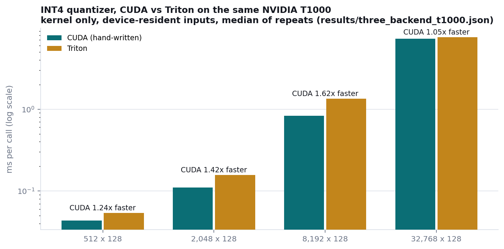
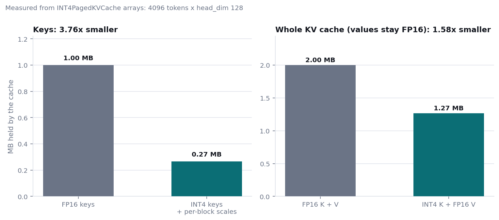
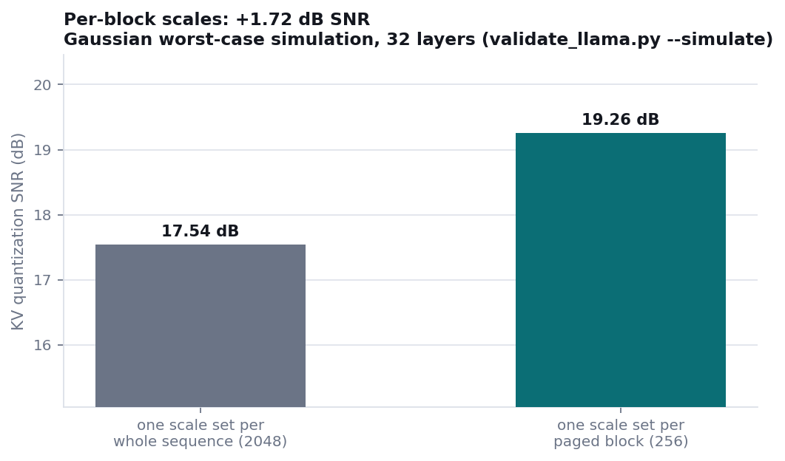
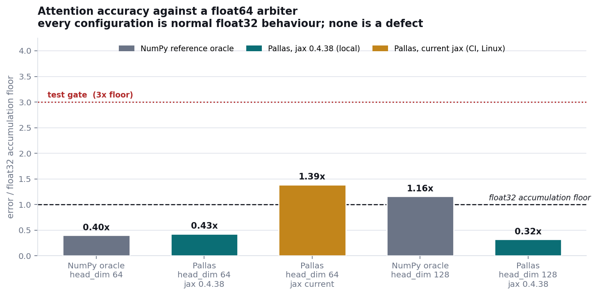
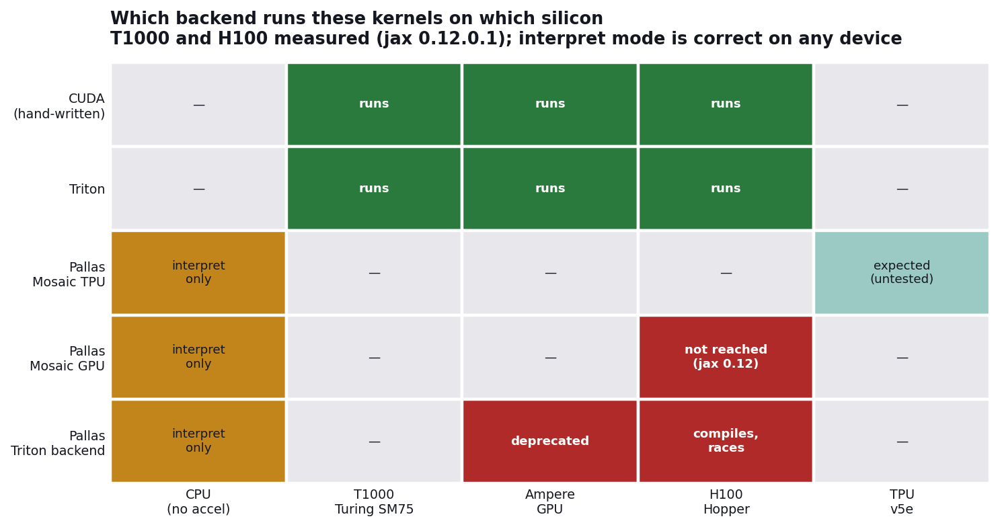
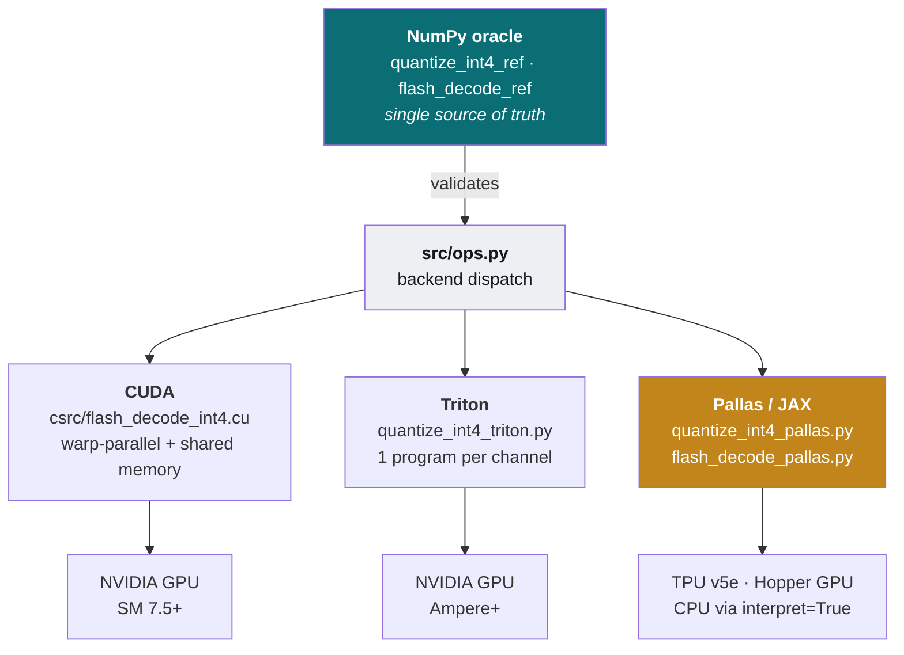
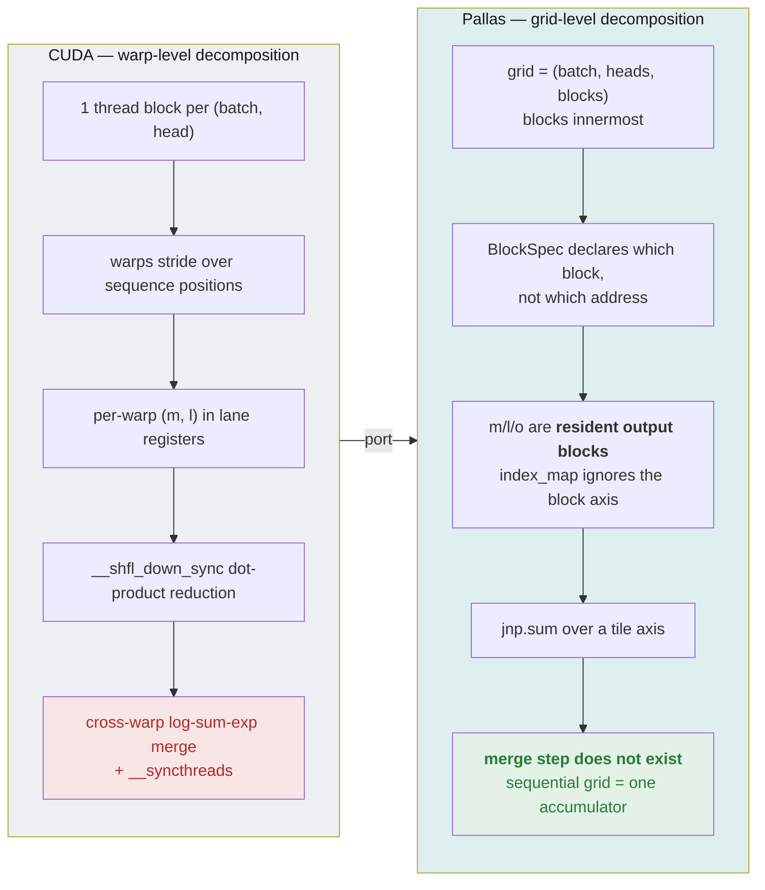
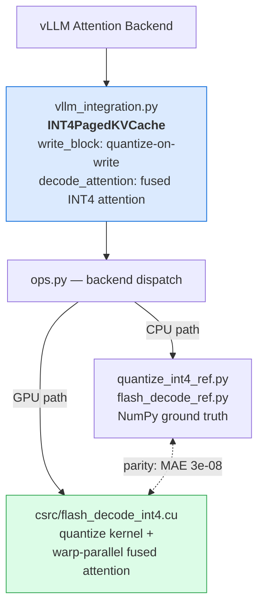
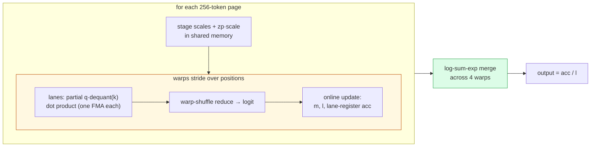

# INT4 KV-Cache Quantization + Fused Flash-Attention Kernels for LLM Inference
### One decode kernel, three backends: CUDA, Triton, and Pallas/JAX (GPU + TPU)

[](https://github.com/ArchanaChetan07/int4-kv-cache-quantization-cuda-triton-pallas/actions/workflows/ci.yml)
[]()
[]()
[]()
[]()
[]()
[]()

Per-channel asymmetric **INT4 quantization** of the KV cache's keys, fused with a
**warp-parallel flash-decoding attention kernel** that dequantizes in registers, so
the FP32 key matrix is never materialized — a **3.76× smaller key cache** (1.58× for
the whole KV cache, since values stay FP16). One algorithm, implemented three times —
**CUDA**, **[Triton](https://github.com/triton-lang/triton)** (quantizer) and
**[Pallas/JAX](https://docs.jax.dev/en/latest/pallas/)** (quantizer + attention) —
every implementation validated against a single NumPy oracle. Designed toward
paged-KV serving engines such as [vLLM](https://github.com/vllm-project/vllm); what
integration still requires is listed under
[Scope and limitations](#scope-and-limitations).

---

## Tech Stack

| Layer | Technologies |
|---|---|
| **GPU kernels** | CUDA C++, warp-level primitives (`__shfl_down_sync`), shared memory, online softmax, PyTorch C++ extension (pybind11) |
| **Kernel DSLs** | OpenAI Triton, JAX Pallas (Mosaic TPU / Mosaic GPU), XLA |
| **Quantization** | INT4 per-channel asymmetric quantization, nibble packing, dequantization in registers, SNR analysis |
| **Attention** | Flash decoding, FlashAttention-style online softmax, paged KV cache, ragged/variable-length sequences |
| **LLM serving** | vLLM-style paged attention, KV-cache compression, decode-step optimization |
| **Languages** | Python, CUDA C++, C++ |
| **Numerics** | NumPy, float64 differential testing, IEEE-754 error analysis, floating-point accumulation bounds |
| **Engineering** | pytest, GitHub Actions CI, Docker, CMake, benchmark harness design, reproducible builds |

**Keywords:** GPU kernel optimization · CUDA programming · Triton kernels · JAX Pallas · TPU kernels ·
INT4 quantization · KV cache · FlashAttention · flash decoding · LLM inference · LLM serving · vLLM ·
model compression · memory bandwidth optimization · numerical validation · ML systems engineering ·
AI infrastructure · high-performance computing

---

## Verified Results

All numbers are measured in this repository and reproducible with the commands shown.

| Check | Result | Hardware |
|---|---|---|
| Test suite, GPU mode (`FLASH_DECODE_JIT_CUDA=1`) | **121 passing** (4 skips: JAX not installed in that env) | NVIDIA T1000, CUDA 12.5 |
| Test suite, JAX environment (Pallas interpret mode) | 96 passing | any machine, no GPU needed |
| Triton quantizer port vs reference | parity via interpreter mode | CI (CPU runners) |
| Pallas quantizer port vs reference | **0.000% bin disagreement**, scales rtol 1e-4 | CI (CPU, interpret mode) |
| Pallas attention vs float64 evaluation | within **1.4x of the float32 accumulation floor** on every tested platform | CI (CPU, interpret mode) |
| Pallas test suite | **21 passing** (8 quantizer, 13 attention) | CI (CPU runners) |
| INT4 nibble packing (2 values/byte) | round-trip exact; stored bytes = ½ unpacked | — |
| CUDA quantizer vs NumPy reference | **0.000% bin disagreement**, scales rtol 1e-4 | T1000 |
| Fused INT4 attention — *agreement* with FP32 reference (head_dim 64) | **MAE 3.1 × 10⁻⁸** | T1000 |
| Variable-length + empty-block edge cases | MAE ≤ 3.4 × 10⁻⁸ | T1000 |
| Attention kernel latency (batch 8 × 32 heads × dim 128 × seq 2048), kernel only | **2.24 ms** median of 9 runs (2.13–2.68 ms); 3.05 ms in the committed sweep — clocks unlocked, so runs vary ±24% | T1000 |
| INT4 quantizer, CUDA vs Triton, same device | CUDA faster at every size: 1.05× to 1.62× | T1000 |
| Key-cache compression vs FP16 (per-256-token-block scales) | **3.76×** measured from the cache's arrays; **1.58×** for the whole KV | — |
| KV quantization SNR (per-block scales, Gaussian worst case) | 19.26 dB, **+1.72 dB** vs whole-sequence scales | — |

> **Agreement is not accuracy.** The 3.1 × 10⁻⁸ figure is how closely the CUDA
> kernel matches the FP32 NumPy reference — not how close either is to the true
> answer. Two implementations sharing a similar accumulation order can agree to
> 3 × 10⁻⁸ while both sit ~2 × 10⁻⁷ from a float64 evaluation. The oracle's own
> error is measured in [docs/TRITON_TO_PALLAS.md §5.1](docs/TRITON_TO_PALLAS.md),
> which is why the Pallas tests gate against a float64 arbiter instead.

**Accuracy gate:** worst-case simulation passes the 0.5% fallback threshold; the hard
< 0.3% perplexity gate runs against real Llama weights (`scripts/validate_llama.py`,
needs a ≥16 GB GPU). **Throughput target:** 2.1–2.8× vs dense FP16 decode.

Every number above is reproducible from committed code: latency and the
CUDA-vs-Triton comparison from `benchmarks/bench_three_backend.py`
(`results/three_backend_t1000.json`), compression from `INT4PagedKVCache`'s arrays,
SNR from `scripts/validate_llama.py --simulate`, and every chart from
`scripts/make_pallas_charts.py`. Timings cover the kernel only, on device-resident
inputs — host-side padding and PCIe copies are excluded (they were 26% of the
end-to-end call even on this card).

<p align="center">
  
</p>

<p align="center">
  
</p>

<p align="center">
  
</p>

**The attention kernel is latency-bound, not bandwidth-bound.** All 256 (batch, head)
programs read one shared page stream, and at the anchor shape the kernel uses
**0.3–0.4% of DRAM bandwidth** on unique bytes. Its streamed read throughput even
exceeds the 160 GB/s DRAM peak at short sequences (213 GB/s at s512) — L2 serving the
shared stream. The cost is the per-position warp-shuffle reduction and serial
softmax update, which makes tiling several positions per warp the next optimization.

---

### Pallas / JAX port — measured results

The same algorithm, written a third time in Pallas and validated against the
**same NumPy oracle** as the CUDA and Triton paths. 21 tests, green in CI on
Linux with the current JAX release.

| Metric | Result |
|---|---|
| Pallas quantizer vs NumPy oracle | **0.000% bin disagreement** — matches the CUDA result, not just the ≤1-bin threshold |
| Scales / zero-points | `rtol 1e-4` / `rtol 1e-3` |
| Attention: ragged pages, empty pages, all-empty | correct; **no NaN**; exact zeros for a fully empty sequence |
| Attention accuracy | within **1.4× of the float32 accumulation floor** on every tested platform |
| Grid-decomposition invariance | bit-identical output across `block_rows` ∈ {64,128,256,512,1024} |
| Pallas test suite | **21 passing** (8 quantizer, 13 attention) |
| CI | 5/5 jobs green — CPU × py3.10/3.11/3.12, Triton interpreter, Pallas interpret |

<p align="center">
  
</p>

Validating against the FP32 reference alone is not sufficient: at `head_dim=128`
the **oracle's own error is 9.26e-07**, so a fixed `3e-08` agreement gate is
unreachable by *any* correct implementation. Accuracy is therefore gated against
a **float64 arbiter**, normalized by the `sqrt(D)·eps·|o|` accumulation floor.
The Windows/Linux gap for Pallas is XLA choosing a different reduction order —
a platform property, not a defect. Full analysis in
[docs/TRITON_TO_PALLAS.md](docs/TRITON_TO_PALLAS.md).

### Why the Pallas leg targets TPU

<p align="center">
  
</p>

Pallas has **no CPU code generator** (`interpret=False` on CPU raises
*"Only interpret mode is supported on CPU backend"*), Mosaic GPU requires
**Hopper/Blackwell**, and the Pallas **Triton backend is deprecated**. A Turing
T1000 sits below both live GPU floors — so correctness runs anywhere via
`interpret=True`, while the performance leg needs TPU v5e or Hopper.

### Three-backend architecture



### What the port actually changed

The algorithm is identical; the *decomposition* is not. This is the core finding:



**42** warp/lane/shuffle/sync tokens in the CUDA kernel → **0** in the Pallas port.
The cross-warp merge isn't simplified, it's *absent*.

---

## How It Works

### Quantization: per-(block, channel) asymmetric INT4 — keys only

```
scale[c] = (max[c] − min[c]) / 15         # over the 256-token page
zp[c]    = −min[c] / scale[c]
q        = clip(round((k − min[c]) / scale[c]), 0, 15)
```

- **Keys only:** logits pass through softmax (bounded sensitivity); values contribute
  linearly to the output and stay FP16/FP32.
- **Per-page scales:** a 256-token page has far tighter min/max than a full sequence —
  measured +1.72 dB SNR over whole-sequence scales.
- **Asymmetric:** captures the full [min, max] range in 4 bits; symmetric INT8 is the
  documented fallback if real-model perplexity regresses > 0.5%.
- **Nibble-packed storage (implemented):** the paged cache stores keys at
  2 INT4 values/byte (`src/int4_pack.py`) — `memory_stats()` reports bytes measured
  from the actual arrays, not an estimate. Kernels currently consume the unpacked
  layout with coalesced uint8 reads (consecutive lanes read consecutive channels);
  packed-native kernel decode is on the roadmap.
- **Three kernel implementations:** CUDA (`csrc/flash_decode_int4.cu`), a
  [Triton](https://github.com/triton-lang/triton) port of the quantizer
  (`src/quantize_int4_triton.py`), and a [Pallas/JAX](https://docs.jax.dev/en/latest/pallas/)
  port of **both** the quantizer and the fused attention kernel
  (`src/quantize_int4_pallas.py`, `src/flash_decode_pallas.py`) — all three
  parity-tested against the same NumPy reference.

### Attention: warp-parallel online softmax (flash-decoding style)

One thread block per (batch, head); inside it:

- **Warps stride over sequence positions**, each with private online-softmax state
  (running max `m`, sum `l`) and an output accumulator living in **lane registers**
- Logits reduce via **warp shuffles** — zero block-wide syncs in the hot loop
- Per-page scales stage in shared memory with zero-points **pre-multiplied by scale**,
  so dequantization is a single FMA in registers during the dot product
- Warps combine at the end with a **log-sum-exp merge**

Multi-block output is verified numerically identical to single-concatenated-block
attention, and empty pages are handled explicitly.

### Architecture



### Inside the fused kernel — one thread block per (batch, head)



No block-wide synchronization in the hot loop; the FP32 key matrix is never
materialized — dequantization happens in registers during the dot product.

---

## Quick Start

### CPU-only (no GPU required)

```bash
git clone https://github.com/ArchanaChetan07/int4-kv-cache-quantization-cuda-triton-pallas.git
cd int4-kv-cache-quantization-cuda-triton-pallas
pip install -e .
pytest tests/ -q                     # GPU-, JAX- and transformers-gated tests skip
python benchmarks/bench_flash_decode.py
python scripts/validate_llama.py --simulate   # hardware-free SNR gate
```

### Pallas / JAX backend (no accelerator required)

Pallas has no CPU code generator, so the kernels run via
`pallas_call(interpret=True)` — the same correctness-without-hardware trick the
Triton port uses with `TRITON_INTERPRET=1`, and what CI runs on every push.

```bash
pip install -e ".[pallas]"
pytest tests/test_pallas_quantize.py tests/test_pallas_flash_decode.py -q   # 21 passed
python benchmarks/bench_three_backend.py --quick --backends reference,pallas
```

```python
from src import ops
q, scale, zp = ops.quantize_int4(kv, backend="pallas")
out = ops.flash_decode(query, k_q, k_scales, k_zps, v_blocks, lens, backend="pallas")
```

Interpret-mode timings are **correctness evidence, not performance numbers**;
the benchmark harness refuses to print a speedup ratio across execution modes.
See [docs/TRITON_TO_PALLAS.md](docs/TRITON_TO_PALLAS.md) for why the performance
leg needs TPU or Hopper-class hardware.

### GPU mode (CUDA GPU + nvcc + PyTorch with CUDA)

The extension JIT-compiles on import and is cached afterward. On Windows, run from
PowerShell or cmd (nvcc's host-compiler subprocess fails under Git Bash/MSYS):

```powershell
$env:FLASH_DECODE_JIT_CUDA = "1"
pytest tests/ -q                     # 121 passed on a T1000 — CUDA + Triton active
```

Or build the extension permanently:
`FLASH_DECODE_FORCE_CUDA=1 pip install --no-build-isolation -e .`
(`--no-build-isolation` so it compiles against your installed torch).

### Usage

```python
import numpy as np
from src.vllm_integration import INT4PagedKVCache

cache = INT4PagedKVCache(num_blocks=4096, block_size=256, head_dim=128)
cache.write_block(block_id=0, k_block=k, v_block=v)   # K quantized to INT4 on write
out = cache.decode_attention(query, block_table=[0])  # fused dequant + online softmax
print(cache.memory_stats())                           # live compression ratio
```

### Real-model perplexity validation (≥16 GB GPU + Llama weights)

```bash
python scripts/validate_llama.py --model meta-llama/Llama-2-7b-hf \
    --output results/perplexity_llama7b.json          # hard <0.3% PPL gate
```

---

## Repository Structure

```
├── src/
│   ├── quantize_int4_ref.py     NumPy ground truth: per-channel asymmetric INT4
│   ├── quantize_int4_triton.py  Triton port of the quantizer
│   ├── quantize_int4_pallas.py  Pallas/JAX port of the quantizer
│   ├── flash_decode_pallas.py   Pallas/JAX port of the fused attention kernel
│   ├── int4_pack.py             nibble packing (2 INT4 values/byte storage)
│   ├── flash_decode_ref.py      NumPy ground truth: online softmax over pages
│   ├── ops.py                   backend dispatch (cuda / triton / pallas / reference)
│   ├── vllm_integration.py      INT4PagedKVCache (quantize + pack on write)
│   └── _jit.py                  opt-in JIT compile of the CUDA extension
├── csrc/
│   ├── flash_decode_int4.cu   quantize kernel + warp-parallel fused attention
│   └── bindings.cpp           PyTorch pybind11 bindings
├── tests/                     quantization, attention, gates, 3-backend parity
├── benchmarks/                latency, compression, and three-backend benchmarks
├── scripts/validate_llama.py  SNR simulation + real-model perplexity harness
├── docs/ARCHITECTURE.md       quantization scheme, kernel design, gates
├── docs/TRITON_TO_PALLAS.md   the port write-up: what transferred, what misled
└── results/                   committed benchmark artifacts
```

## Correctness Gates

| Gate | Where | Threshold | Status |
|---|---|---|---|
| INT4 round-trip error | `test_quantization.py` | ≤ scale/2 per value | ✅ |
| Multi-block ≡ concatenated attention | `test_flash_decode.py` | MAE < 1e-5 | ✅ |
| CUDA ⇄ reference parity | `test_ops_dispatch.py` | MAE < 1e-3 | ✅ (3e-08) |
| Scaled-query attention drift | `test_vllm_integration.py` | MAE < 0.05 | ✅ |
| One input contract, every backend | `test_ops_dispatch.py` | malformed pages / lengths raise identically | ✅ |
| CUDA kernel shape boundaries | `test_ops_dispatch.py` | head_dim 1–256, ragged pages | ✅ |
| Perplexity harness measures INT4 keys | `test_perplexity_harness.py` | hook fires; loss changes | ✅ |
| SNR simulation (worst case) | `validate_llama.py --simulate` | < 0.5% est. PPL | ✅ |
| Real-model perplexity | `validate_llama.py` | < 0.3% PPL delta | pending (needs ≥16 GB GPU) |

## Scope and limitations

Stated plainly, so a reviewer does not have to discover them:

- **Shared page stream.** The CUDA and Pallas attention kernels attend every query in
  the `[batch, heads]` grid over **one** sequence's KV pages — MQA-style, or many
  queries against one shared prefix. A vLLM attention backend additionally needs a
  per-sequence block table and per-KV-head indexing; that is the integration
  milestone, not done.
- **Latency-bound kernel.** See above: 0.3–0.4% DRAM utilization at the anchor shape.
  The earlier claim that it ran near the bandwidth roofline was wrong.
- **Perplexity is measured by fake quantization.** `validate_llama.py` quantizes
  post-RoPE keys inside PyTorch attention, which measures the accuracy cost of the
  INT4 scheme; the kernels' agreement with that scheme is established separately by
  the parity tests.
- **Pallas has never been compiled.** All Pallas results are interpret mode; the
  lowering probe (`scripts/pallas_lowering_probe.py`) needs TPU or Hopper hardware.
- **T1000 timings vary ±24%.** Boost clocks cannot be locked without admin rights, so
  report medians and ranges, not single runs.
- **The serial v1 kernel is not in this repository.** An early serial version timed at
  10.95 ms predates the history; that comparison is not reproducible and is no
  longer cited.

## Roadmap

- [x] NumPy reference: quantizer + online softmax
- [x] CUDA kernels — agreement with the reference at MAE 3e-08; 2.24 ms at the anchor shape on a T1000
- [ ] Tile several positions per warp — the kernel is latency-bound (0.3–0.4% DRAM utilization)
- [x] Triton port of the quantizer (CI-validated via interpreter mode)
- [x] Pallas/JAX port of the quantizer **and** the fused attention kernel
      (CI-validated via `interpret=True`) — see [docs/TRITON_TO_PALLAS.md](docs/TRITON_TO_PALLAS.md)
- [ ] Pallas performance leg on TPU v5e — blocked on hardware, not on code:
      Pallas has no CPU code generator, Mosaic GPU needs Hopper+, and the
      Pallas Triton backend is deprecated
- [x] INT4 nibble packing (2 values/byte) in the cache storage path
- [x] JIT build path + packaging + CI + Docker
- [ ] Packed-native kernel decode (read nibbles directly in the attention kernel)
- [ ] Real-model perplexity gate on Llama-2-7B/13B/70B (needs ≥16 GB GPU)
- [ ] vLLM attention-backend integration; benchmark vs TensorRT-LLM / SGLang baselines

## Project report (PDF)

A 12-page technical report covering the whole project — algorithm, the three
implementations, the port methodology, measured results, the four findings, the
benchmark integrity design, and an explicit section on what has *not* been
established: **[docs/INT4_KV_Pallas_Project_Report.pdf](docs/INT4_KV_Pallas_Project_Report.pdf)**

Regenerate with `python scripts/make_project_pdf.py`. Every figure and number in
it is produced by this repository.

## Running on rented GPU hardware

The performance leg needs a Hopper-class GPU or a TPU — Pallas has no CPU code
generator, and the local Turing card is below both live Pallas GPU floors.
[docs/H100_RUNBOOK.md](docs/H100_RUNBOOK.md) is a costed, ordered runbook
(~$3–5, ~1.5 h) with fail-fast preflight so rented time goes to science instead
of setup:

```bash
bash scripts/h100_bootstrap.sh     # install, build, preflight
export FLASH_DECODE_JIT_CUDA=1
bash scripts/h100_run_all.sh       # tests -> lowering probe -> benchmarks -> perplexity
```

`scripts/pallas_lowering_probe.py` is the step that matters: it is the first
time these kernels meet a real compiler. `REJECTED` and `MISMATCH` are treated
as publishable findings, not failures.

## Engineering Practices Demonstrated

- **Differential testing against a higher-precision oracle** — attention accuracy is
  gated against a float64 arbiter and normalized by the IEEE-754 accumulation floor,
  because the FP32 reference is itself at the noise floor and cannot certify a kernel.
- **Cross-platform numerical validation** — a tolerance that passed locally failed in
  Linux CI; root-caused to XLA reduction-order choice and corrected to test the
  invariant physics rather than a platform accident.
- **Benchmark integrity** — identical seeded inputs across backends, sweep fixed before
  timing, MBU (memory-bandwidth utilization) as the cross-device metric, and anti-cheat
  assertions: output-consumed, no-shape-specialization, kernel-present-in-compiled-HLO.
  The harness records `execution_mode` and **refuses** to print a ratio across modes.
- **Hardware-honest reporting** — unavailable backends are recorded with a reason, never
  silently omitted; interpret-mode timings are labelled as correctness evidence, not
  performance numbers.
- **Pre-registered hypotheses** — 14 predictions written before the port, scored after:
  10 confirmed, **1 refuted**, 3 unresolved pending TPU access.
- **CI without accelerators** — Triton validated via `TRITON_INTERPRET=1`, Pallas via
  `pallas_call(interpret=True)`; 5/5 jobs green on CPU-only runners.
- **Measurements that prove they measured something** — the perplexity harness raises
  unless its INT4 hook fired and changed the keys (an earlier version quantized the
  cache *after* the loss was computed and reported 0.000% by construction); the
  benchmark asserts the timed path matches the validated dispatch path.
- **Kernel-only timing** — inputs staged on the device once; host padding and PCIe
  excluded from every timed region.
- **Memory safety at every layer** — head_dim and page-length limits enforced in the
  CUDA launcher, the C++ bindings and the dispatch layer, with boundary tests.

## Related Projects

Part of a three-repo LLM inference optimization portfolio:

- **[CUDA Speculative Decoding Optimizer](https://github.com/ArchanaChetan07/CUDA-Accelerated-Speculative-Decoding-Optimizer-for-LLM-Inference-PyTorch-vLLM-)** — deterministic draft ranking + soft-lock KV conflict resolution
- **[GPU Memory-Aware Request Scheduler](https://github.com/ArchanaChetan07/GPU-Memory-Aware-Request-Scheduler-with-KV-Cache-Offloading-for-Multi-Tenant-LLM-Serving)** — SLA-aware admission control with sub-millisecond KV offloading

## License

Apache-2.0
